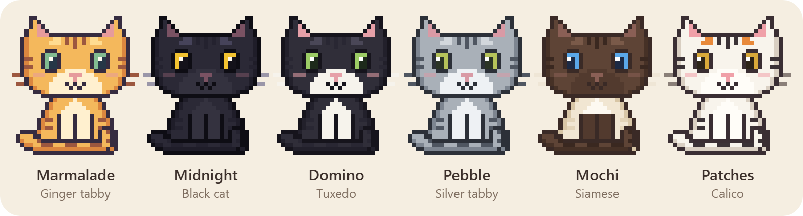

# Desktop Cat

A pixel-art tabby that lives on your desktop (Electron, cross-platform). Requires Node.js 22.12+.

    npm ci
    npm start          # tray icon, or right-click the cat: cat, size, interest level, toys, settings
    npm run dist       # package with electron-builder (fetched on demand)
    npx electron scripts/selftest.js   # smoke test (use xvfb-run --no-sandbox on headless Linux)
    npx electron scripts/selftest.js --multi-monitor   # simulated mixed-DPI four-screen regression test

## Installing behind a restricted npm registry
- The default install only needs `electron` and the optional `active-win`. `electron-builder` is not installed by `npm ci`; `npm run dist` downloads it with `npx`, so run packaging where the public npm registry is reachable.
- `package-lock.json` is generated with `npm install --min-release-age=30`, because some corporate feeds don't serve very new releases. Use the same flag when updating dependencies.
- `allowScripts` approves only `active-win`'s install script, which fetches its native binding from GitHub. If that fails, npm skips the optional package and the cat just won't perch on windows.
- Electron downloads its binary from GitHub on the first `npm start`.

## Behaviour
- Idle: sits, loafs, grooms, stretches, wanders, and naps when you're idle or at night (23:00–07:00). Before a nap it turns round a few times and kneads; it wakes with a stretch and a yawn, and washes after a meal.
- Interest slider (0 ignore everything → 4 play with everything) controls how often and how eagerly it reacts.
- Checks on you: walks to the cursor, notices typing (input with a still cursor), sizes up and jumps onto the top of your active window (needs `active-win`; optional), paces across it while you type (level 4), and knocks a cup off the window edge (level 3+).
- Toys from the tray: yarn ball, laser pointer (follows your cursor), food bowl. A ball lying close by gets patted along with a front paw: paw up, a tentative tap or two, a proper bat, then after it to bat it again, now and then sending it flying. A ball that has stopped rolling further off gets stalked: belly low, a creep, a rear-end wiggle, then a pounce. If it misses, it grooms as if it meant to.
- Batting at the cursor: wiggle the cursor right next to the cat and, if it is excited and interested enough (level 2+, much keener at 3–4), it bats at it with a paw. It never moves your cursor.
- Climbing: a playful cat climbs up and down the edges between stacked screens and up the side of a window too tall to jump onto, to reach a yarn ball or explore. A lazier cat sits below what it can't reach, tail twitching and chattering, and may eventually work up the courage. Climbing is rare at low interest and common at level 4. A climbing or leaping cat may pass in front of a taskbar.
- Body language: eyes follow what it's watching and go wide on the hunt, the tail twitches when it's hunting, it slow-blinks at a cursor resting quietly nearby, and at level 3+ it sometimes gets the zoomies, most often around dawn and dusk.
- Animated pixel-art poses. Silent for now; no meows or purrs. Reduced-motion settings freeze the decorative animation, slow blinks and zoomies, and a batting cat holds its paw out rather than swiping.
- Starts on the primary monitor. Supports stacked, offset and mixed-DPI monitors, keeps the full sprite above shorter-screen edges, and returns to the primary screen after display-layout changes.
- Right-click the cat for the same menu as the tray icon. The overlay lets clicks through everywhere except on the cat itself, so other clicks on the cat do nothing.
- Lost the cat? Right-click the tray icon and choose **Bring cat here** to summon it onto that screen.

## Cats and size
- **Settings… → Choose your cat** shows a gallery of built-in cats: Marmalade (ginger tabby, the default), Midnight (black), Domino (tuxedo), Pebble (silver tabby), Mochi (Siamese) and Patches (calico). The tray's **Cat** submenu switches between them as well.
- **Size** (tray or settings) runs from Tiny to Giant. Bigger cats walk, climb and jump further.
- **Build a cat…** in settings: pick colours for each part of the coat, with optional Siamese-style colour points. Custom cats can be edited or deleted.
- **Share** saves a cat as a `.desktopcat.json` file and **Import a cat…** adds one, so cats can be passed to other people. The format is plain JSON:

      { "format": "desktop-cat.coat", "version": 1, "name": "Smokey", "description": "optional", "author": "optional",
        "palette": { "fur": "#5a5e66", "eyes": "#d9b43c", ... }, "points": { ... } }

  Palette keys are `fur`, `shade`, `markings`, `highlight`, `belly`, `outline`, `nose`, `eyes`, `pupil`, `glint` and `whiskers`, all `#rrggbb`. Missing colours fall back to the default cat's. Files from a newer version, or anything else that isn't a cat, are refused.

## Known limits
- No global click detection (would need a native hook such as uiohook-napi); the cat only notices clicks on itself.
- Wayland: always-on-top transparent overlay, cursor polling and active-window lookup are unreliable.
- Sprite artwork and animation live in `renderer/pixel-cat.js`, coats and the cat file format in `renderer/coats.js`, and behaviour in `renderer/cat.js`.
- Other cat designs (Classic, Floof and Bean) are kept as prototypes in `design/prototypes/`. Open its `index.html` in a browser to see them animated next to the app's cat; `options.png` is the original comparison.
